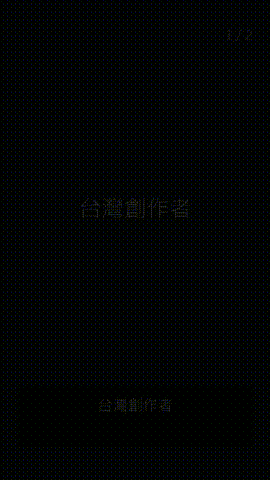

# 安達免費字卡影片

輸入幾行文字，在 Windows 本機做出直式字卡短影片，畫面含動態與字幕。無須卡密或 API 金鑰。

## 三步驟安裝

1. 到本專案右側的 **Releases** 下載 `安達免費字卡影片-Setup.exe`，雙擊安裝，無須系統管理員權限。
2. 從桌面開啟「安達免費字卡影片」，每行輸入一句文字。
3. 按「製作影片」並選擇儲存位置，即可取得 MP4。

開發者可執行 `python title_video.py --text "第一張`n第二張" --output demo.mp4`；建置需 Python、Pillow、PyInstaller、NSIS 及 LGPL shared FFmpeg，並執行 `powershell -NoProfile -ExecutionPolicy Bypass -File build.ps1 -FFmpegBin <FFmpeg bin 資料夾>`。

免費版一次最多 20 張字卡，每行一張，約 2 秒一張。使用者須自行確認輸入文字的權利。對單純文字字卡影片，可用它取代剪映／CapCut 的字卡製作步驟；完整剪輯功能仍需其他工具。

## 授權

安達原創程式採 [PolyForm Noncommercial 1.0.0](LICENSE)，原始碼公開供非商業用途；這是 source-available 授權，不屬於 OSI 定義的開源授權。商用需求見 [COMMERCIAL.md](COMMERCIAL.md) 或 https://anda.biz。第三方授權見 [THIRD_PARTY.md](THIRD_PARTY.md)。

## English

Anda Free Title Video turns lines of text into animated vertical card videos with visible captions, entirely on your Windows PC. Install the local Windows package, type one card per line, and save an MP4. No account, API key, or activation code is required. The Anda code is source-available under PolyForm Noncommercial 1.0.0; commercial licensing is available at https://anda.biz. Third-party components retain their own licenses.
